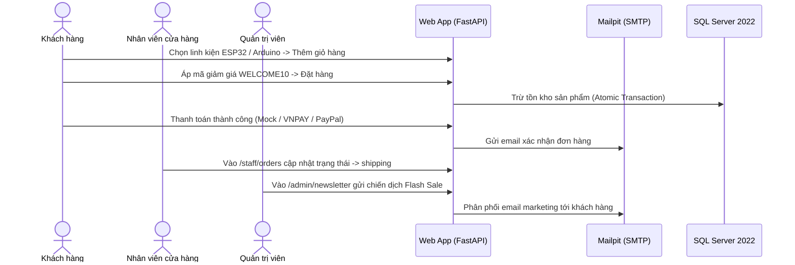

# ElectroHub — Kịch Bản Demo & Nghiệm Thu Đồ Án

[← Về README chính](README.md) · [Hướng dẫn Developer](DEV.md) · [Tiến độ & Guideline](guideline/README.md)

Tài liệu này cung cấp toàn bộ kịch bản, tài khoản mẫu, thông tin thanh toán thử nghiệm và các bước hướng dẫn từng bước để giảng viên hoặc ban đánh giá nghiệm thu đồ án ElectroHub.

---

## 🔑 1. Thông tin Tài khoản Thử nghiệm (Demo Accounts)

Hệ thống đã nạp sẵn 3 tài khoản tương ứng với 3 cấp độ phân quyền trong hệ thống. Tất cả đều sử dụng mật khẩu chung:

👉 **Mật khẩu dùng chung**: **`Demo@2026!`**

| Vai trò | Email đăng nhập | Quyền hạn và Đường dẫn giao diện |
| :--- | :--- | :--- |
| **Khách hàng (Customer)** | `customer.demo@example.com` | Duyệt hàng, thêm giỏ, đặt hàng, quản lý đơn cá nhân tại [`/account/orders`](http://localhost:8000/account/orders) |
| **Nhân viên (Staff)** | `staff.demo@example.com` | Tiếp nhận đơn, cập nhật trạng thái đơn (chờ xử lý, đang giao, đã giao) tại [`/staff/orders`](http://localhost:8000/staff/orders) |
| **Quản trị viên (Manager)** | `manager.demo@example.com` | Toàn quyền hệ thống: quản lý sản phẩm ([`/admin/products`](http://localhost:8000/admin/products)), duyệt hoàn tiền ([`/admin/refunds`](http://localhost:8000/admin/refunds)), gửi email marketing ([`/admin/newsletter`](http://localhost:8000/admin/newsletter)) |

---

## 💳 2. Thông tin Thẻ Thanh toán Sandbox

Khi cấu hình `PAYMENT_MODE=sandbox`, bạn có thể dùng các thông tin thẻ test dưới đây để thực hiện thanh toán thật trên môi trường sandbox:

### A. Cổng thanh toán VNPAY (Thẻ ATM nội địa):
- **Ngân hàng**: `NCB`
- **Số thẻ**: `9704198526191432198`
- **Tên chủ thẻ**: `NGUYEN VAN A`
- **Ngày phát hành**: `07/15`
- **Mã OTP**: `123456`

### B. Cổng thanh toán PayPal (Thẻ VISA quốc tế):
- **Số thẻ VISA ảo**: `4005519200000004`
- **Ngày hết hạn**: Bất kỳ tháng/năm nào trong tương lai (ví dụ: `12/28`)
- **Mã CVV**: `123`

*(Lưu ý: Ở chế độ mặc định `PAYMENT_MODE=mock`, trang `/payments/{code}` có sẵn 2 nút bấm **"Mô phỏng Thanh toán Thành công"** và **"Mô phỏng Thất bại"**, không cần nhập thẻ).*

---

## 🎬 3. Các Kịch Bản Demo Nghiệm Thu



---

### 🟢 Kịch bản 1: Luồng Mua hàng của Khách hàng (Storefront & Checkout)
1. Truy cập trang chủ: [http://localhost:8000](http://localhost:8000).
2. Đăng nhập với tài khoản: `customer.demo@example.com` / `Demo@2026!`.
3. Vào danh mục sản phẩm: [http://localhost:8000/collections/all](http://localhost:8000/collections/all).
4. Thử tìm kiếm hoặc lọc theo giá/danh mục (ví dụ: Vi điều khiển ESP32, Cảm biến nhiệt độ).
5. Bấm vào chi tiết sản phẩm, chọn số lượng và bấm **"Thêm vào giỏ hàng"**.
6. Mở giỏ hàng tại [http://localhost:8000/cart](http://localhost:8000/cart):
   - Nhập mã voucher: **`WELCOME10`** để được giảm ngay 10%.
   - Bấm **"Tiến hành Đặt hàng"**.
7. Điền thông tin giao hàng và chọn phương thức thanh toán (Mock / VNPAY / PayPal).
8. Tại trang thanh toán [`/payments/{code}`](http://localhost:8000):
   - Bấm **"Mô phỏng Thanh toán Thành công"**.
   - Trạng thái đơn đổi thành `confirmed`.
9. Kiểm tra lịch sử đơn hàng tại [http://localhost:8000/account/orders](http://localhost:8000/account/orders).

---

### 🟡 Kịch bản 2: Luồng Quản trị & Xử lý Đơn hàng (Staff & Admin)
1. Đăng xuất và đăng nhập với tài khoản Nhân viên: `staff.demo@example.com` / `Demo@2026!`.
2. Truy cập trang quản lý đơn: [http://localhost:8000/staff/orders](http://localhost:8000/staff/orders).
3. Tìm đơn hàng vừa tạo ở Kịch bản 1:
   - Chuyển trạng thái sang `shipping` (Đang giao hàng).
   - Chuyển trạng thái sang `done` (Đã giao hàng thành công).
4. Đăng nhập với tài khoản Quản trị: `manager.demo@example.com` / `Demo@2026!`.
5. Vào quản lý sản phẩm: [http://localhost:8000/admin/products](http://localhost:8000/admin/products) (có thể thêm, sửa giá, cập nhật tồn kho).
6. Vào gửi email marketing: [http://localhost:8000/admin/newsletter](http://localhost:8000/admin/newsletter):
   - Chọn mẫu chiến dịch **"⚡ Khuyến mãi / Flash Sale cuối tuần"**.
   - Bấm **"Gửi chiến dịch"**.
   - Mở giao diện hộp thư ảo Mailpit tại [http://localhost:8025](http://localhost:8025) để xem trực tiếp các email HTML vừa gửi đến hộp thư khách hàng!

---

### 🔵 Kịch bản 3: Nghiệm thu Cơ sở dữ liệu T-SQL môn học (SQL Server 2022)
Mở SSMS trên Windows Parallels (kết nối `<IP của máy tính>,1434`, user `sa`, pass `ElectroHub@123`) hoặc chạy trực tiếp bằng dòng lệnh:

#### 1. Kiểm chứng Trigger trừ tồn kho và hoàn kho (`03_triggers.sql`)
```sql
USE [ElectroHub];
GO

-- 1. Xem tồn kho ban đầu của ESP32 (ID = 1)
SELECT id, sku, name, stock FROM dbo.products WHERE id = 1;

-- 2. Thử đặt mua số lượng vượt quá tồn kho -> Trigger CHẶN VÀ ROLLBACK
INSERT INTO dbo.order_items (order_id, product_id, price, qty)
VALUES (3, 1, 75000, 9999);
-- Thông báo lỗi: Lỗi tồn kho: Sản phẩm không đủ đáp ứng!

-- 3. Đặt mua số lượng hợp lệ (5 chiếc) -> Tự động trừ tồn kho
INSERT INTO dbo.order_items (order_id, product_id, price, qty)
VALUES (3, 1, 75000, 5);
SELECT id, stock FROM dbo.products WHERE id = 1;

-- 4. Hủy đơn hàng -> Trigger TỰ ĐỘNG HOÀN LẠI 5 chiếc vào kho
UPDATE dbo.orders SET status = 'cancelled' WHERE id = 3;
SELECT id, stock FROM dbo.products WHERE id = 1;
```

#### 2. Kiểm chứng Trigger chống sửa/xóa đơn hàng đã hoàn tất
```sql
-- Đơn hàng số 1 đã ở trạng thái 'done'
UPDATE dbo.orders SET total = 0 WHERE id = 1;
-- Thông báo lỗi: Không được phép sửa đổi thông tin của đơn hàng đã hoàn tất!
```

#### 3. Kiểm chứng Cursor phân hạng VIP và tặng Voucher tri ân (`05_cursors.sql`)
```sql
-- Con trỏ duyệt qua toàn bộ lịch sử chi tiêu của khách hàng, xếp hạng và tặng voucher
EXEC dbo.sp_Cursor_PhanHangVaTangVoucherKhachHang;

-- Xem các voucher VIP vừa được Cursor tự động sinh ra:
SELECT * FROM dbo.vouchers WHERE code LIKE 'VIP%';
```

#### 4. Kiểm chứng Views báo cáo doanh thu (`06_views_and_functions.sql`)
```sql
SELECT * FROM dbo.v_ThongKeSanPhamVaDoanhSo;
SELECT * FROM dbo.v_BaoCaoDoanhThuTheoThang;
```

---

## ⚡ 4. Chạy Kiểm Thử Tự Động Toàn Diện (Automated Verification)

Chỉ với 2 câu lệnh, bạn có thể chứng minh 100% hệ thống hoạt động chính xác:

```bash
# 1. Kiểm thử toàn bộ 106 unit & integration tests của Web App (100% Passed)
python -m pytest -v

# 2. Kiểm thử toàn bộ 100% các thành phần T-SQL (Triggers, Cursors, SPs, Views, Rules)
docker compose exec -T sqlserver-test /opt/mssql-tools18/bin/sqlcmd \
    -S localhost -U sa -P "ElectroHub@123" -C -i /sql/test_all.sql
```
