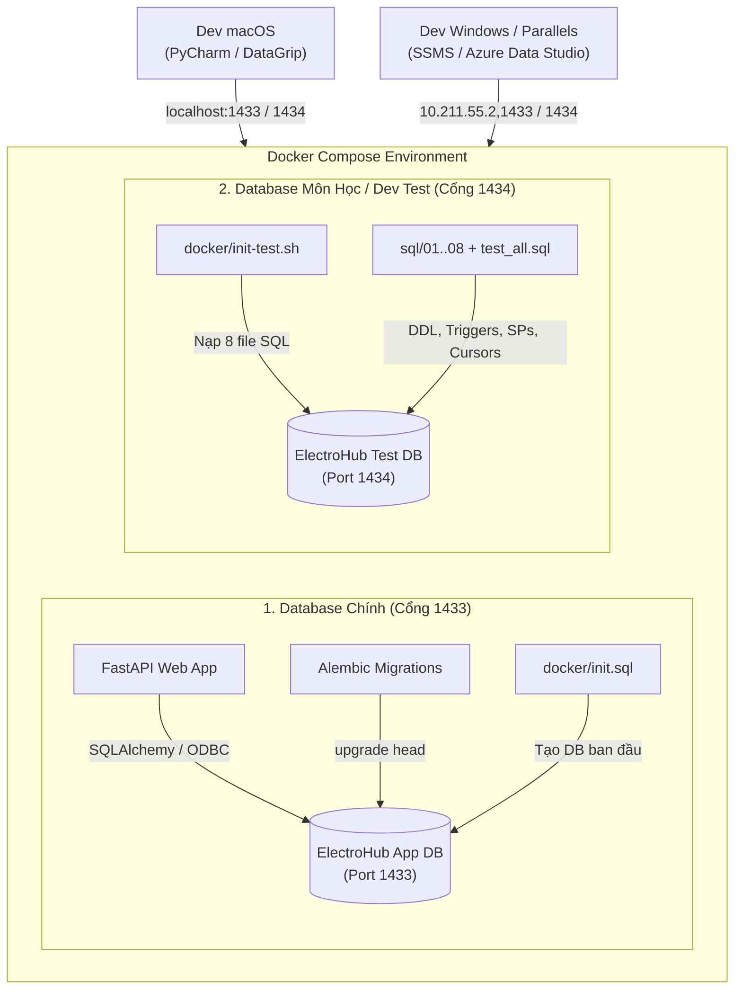

# DB & Migration — SQL Server 2022 + Alembic & T-SQL Suite

[← Trang bắt đầu / chọn thành viên](README.md) · [Tra cứu theo công việc](README.md#lookup) · [README chính](../README.md)

Tài liệu quy định kiến trúc cơ sở dữ liệu, quy trình migration và bộ thành phần T-SQL phục vụ đồ án Web và môn học Hệ Quản Trị Cơ Sở Dữ Liệu SQL Server 2022.

---

<a id="architecture"></a>

## 1. Kiến trúc Hai Cơ Sở Dữ Liệu Song Song (Dual Database Strategy)

Để đảm bảo vừa phục vụ trơn tru cho ứng dụng Web FastAPI vừa đáp ứng trọn vẹn yêu cầu chuyên sâu của môn học (Triggers, Cursors, Rules, Stored Procedures...), hệ thống Docker triển khai 2 Database độc lập:



### So sánh vai trò:
| Tiêu chí | 1. Database Chính (Web App) | 2. Database Môn Học / Dev Test |
| :--- | :--- | :--- |
| **Service Compose** | `sqlserver` | `sqlserver-test` |
| **Cổng Host** | `0.0.0.0:1433:1433` | `0.0.0.0:1434:1433` |
| **Cơ chế khởi tạo** | `docker/init.sql` + Alembic migration | `docker/init-test.sh` + toàn bộ `sql/*.sql` |
| **Mục đích** | Chạy Web App, API giỏ hàng, thanh toán | Thực hành môn học: viết Trigger, Cursor, SP, View |
| **Volume dữ liệu** | `sqlserver_data` | `sqlserver_test_data` |
| **Tài khoản / Mật khẩu** | `sa` / `ElectroHub@123` | `sa` / `ElectroHub@123` |

---

<a id="roles"></a>

## 2. Quy định vai trò và quyền quản trị

* **Dũng P1** sở hữu ERD, migration nền tảng và bộ script T-SQL.
* **Giàu P2** (Catalog) và **Hưng P3** (Sales): Đề xuất thay đổi schema qua issue / PR, Dũng review và thống nhất trước khi áp dụng.
* Mọi bảng trên Database chính bắt buộc đi qua Alembic migration có version. **Tuyệt đối không chạy lệnh `ALTER TABLE` bằng tay trên SSMS ở DB chính** rồi quên ghi lại vào mã nguồn.
* Trên Database Test (`1434`), các thành viên được toàn quyền thực nghiệm, chạy lại các kịch bản test, viết thêm Trigger, Stored Procedure hoặc Cursor.

---

<a id="erd"></a>

## 3. Cấu trúc ERD chuẩn

```text
users(id, email UQ, password_hash, name, role, created_at)
products(id, slug UQ, sku UQ, name, description, image_url, price, sale_price, stock, created_at)
vouchers(id, code UQ, percent, max_discount, qty_left, expired_at)
cart_items(id, user_id FK, product_id FK, qty, created_at, UQ(user_id, product_id))
orders(id, code UQ, user_id FK, status, subtotal, discount, shipping_fee, total, voucher_code, address JSON, created_at)
order_items(id, order_id FK, product_id FK, price, qty)
payments(id, order_id FK UQ, method, status, payload JSON, created_at)
refunds(id, order_id FK, user_id FK, amount, reason, status, created_at, updated_at)
newsletter_subscribers(id, email UQ, is_active, created_at)
email_campaigns(id, subject, body, sent_count, created_at)
```

Quy ước chung:
* Khóa chính: `id INT IDENTITY(1,1) PRIMARY KEY`.
* Số tiền: `INT` (đơn vị Việt Nam Đồng).
* Thời gian: `DATETIME2` theo chuẩn UTC (mặc định lấy `SYSUTCDATETIME()`).
* Chuỗi ký tự có dấu: `NVARCHAR`, chuỗi định danh/mã code: `VARCHAR`.

---

<a id="tsql-components"></a>

## 4. Bộ thành phần T-SQL phục vụ môn học (`sql/`)

Toàn bộ các đối tượng T-SQL nâng cao được đóng gói thành từng module độc lập trong thư mục [`sql/`](../sql/):

1. **Rules & Defaults ([`02_rules_defaults.sql`](../sql/02_rules_defaults.sql))**:
   - `rule_GiaKhongAm`: Đảm bảo giá bán và đơn giá không âm (`@gia >= 0`).
   - `rule_SoLuongHopLe`: Giới hạn số lượng mua hàng hợp lệ từ 1 đến 99 (`@qty BETWEEN 1 AND 99`).
   - `rule_PhanTramVoucher`: Ràng buộc phần trăm giảm giá từ 1 đến 100 (`@pct BETWEEN 1 AND 100`).
   - Ràng buộc vào cột qua hệ thống thủ tục hệ thống `sp_bindrule` và `sp_bindefault`.

2. **Triggers ([`03_triggers.sql`](../sql/03_triggers.sql))**:
   - `trg_KiemTraVaTruTonKho`: Tự động kiểm tra số lượng tồn kho khi tạo chi tiết đơn hàng (`order_items`), trừ kho tự động hoặc ROLLBACK nếu hết hàng.
   - `trg_HoanKhoKhiHuyDonHang`: Khi đơn hàng chuyển trạng thái sang `cancelled`, tự động cộng hoàn trả lại tồn kho vào bảng `products`.
   - `trg_ChongSuaXoaDonHangDaDong`: Ngăn chặn mọi thao tác sửa hoặc xóa dữ liệu đối với đơn hàng đã hoàn tất (`done`).
   - `trg_DongBoThanhToanKhiHoanTien`: Tự động đồng bộ trạng thái thanh toán khi hoàn tiền được phê duyệt.

3. **Stored Procedures ([`04_stored_procedures.sql`](../sql/04_stored_procedures.sql))**:
   - `sp_TaoDonHangTuGioHang`: Xử lý giao dịch đặt hàng nguyên tử (Atomic Transaction), tự động tính toán voucher và xóa sạch giỏ hàng.
   - `sp_HuyDonHangVaYeuCauHoanTien`: Quản lý nghiệp vụ hủy đơn và khởi tạo yêu cầu hoàn tiền an toàn.
   - `sp_BaoCaoDoanhThu`: Báo cáo doanh số kinh doanh tổng hợp theo khoảng thời gian tùy chọn.

4. **Cursors ([`05_cursors.sql`](../sql/05_cursors.sql))**:
   - `sp_Cursor_XuLyDonHangPendingQuaHan`: Quét từng dòng đơn hàng pending quá hạn, tự động hủy và hoàn tồn kho.
   - `sp_Cursor_PhanHangVaTangVoucherKhachHang`: Tính tổng chi tiêu của từng khách hàng, xếp hạng hạng VIP và sinh voucher tri ân.
   - `sp_Cursor_QuetKiemTraYeuCauHoanTien`: Duyệt danh sách yêu cầu hoàn tiền tự động dưới ngưỡng quy định.

5. **Views & Functions ([`06_views_and_functions.sql`](../sql/06_views_and_functions.sql))**:
   - Scalar Functions: `fn_TinhTongTienDonHang`, `fn_KiemTraVoucherHopLe`.
   - Table-Valued Function: `fn_LichSuDonHangUser`.
   - Views: `v_ChiTietDonHangTongHop`, `v_ThongKeSanPhamVaDoanhSo`, `v_BaoCaoDoanhThuTheoThang`.

6. **Transactions & Concurrency Control ([`07_transactions_concurrency.sql`](../sql/07_transactions_concurrency.sql))**:
   - Áp dụng Savepoint: `SAVE TRANSACTION SavePoint_SauKhiTruKho`.
   - Khóa bản ghi chống Race Condition khi đặt hàng: `SELECT ... FROM products WITH (UPDLOCK, ROWLOCK)`.
   - Minh họa các cấp độ cô lập: `READ COMMITTED`, `SNAPSHOT`, `SERIALIZABLE`.

7. **Kiểm thử tự động ([`test_all.sql`](../sql/test_all.sql))**:
   - Kịch bản chạy toàn diện xác thực tính đúng đắn của toàn bộ 100% Rules, Triggers, Procedures và Cursors.

---

<a id="workflow"></a>

## 5. Quy trình Migration với Alembic (Dành cho Web App)

```sh
# Tạo migration mới khi cập nhật model SQLAlchemy
alembic revision --autogenerate -m "mo_ta_thay_doi"

# Áp dụng migration lên DB
alembic upgrade head

# Rollback thử 1 bước (Bắt buộc kiểm tra trước khi gửi PR)
alembic downgrade -1
alembic upgrade head
```

---

<a id="ssms-connection"></a>

## 6. Hướng dẫn kết nối SSMS trên Windows Parallels

1. **Server Name**: `<IP của máy tính>,1434` (DB Test môn học) hoặc `<IP của máy tính>,1433` (DB Web App).
2. **Authentication**: `SQL Server Authentication`.
3. **User Name**: `sa`.
4. **Password**: `ElectroHub@123`.
5. **Trust Server Certificate**: **Bắt buộc TÍCH CHỌN ☑** (Do SQL Server Docker sử dụng chứng chỉ tự ký).
