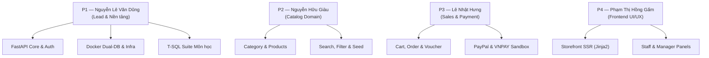

# ElectroHub — Báo Cáo Tiến Độ & Hoàn Thành Dự Án

[← Về README chính](../README.md) · [Hướng dẫn Developer](../DEV.md) · [Kịch bản Demo](../DEMO.md)

Tài liệu tổng hợp hiện trạng triển khai, các phần đã hoàn thành của đồ án ElectroHub, phân công nhiệm vụ và danh mục tài liệu kỹ thuật chuyên sâu.

---

## 📊 1. Bảng Tổng Kết Trạng Thái Hoàn Thành Dự Án

Dự án ElectroHub đã hoàn thành **100% các hạng mục nghiệp vụ và kỹ thuật đề ra**:

| Domain / Hạng mục | Người phụ trách | Trạng thái | Nội dung đã hoàn thành |
| :--- | :--- | :--- | :--- |
| **Nền tảng & Auth** | **Nguyễn Lê Văn Dũng (P1)** | **100% Hoàn thành** | Khung FastAPI, bảo mật JWT qua HttpOnly cookie, kiểm tra CSRF hai chiều, phân quyền 3 cấp (Customer, Staff, Manager), CLI tạo quản trị viên `app.create_admin`. |
| **Kiến trúc Docker & DB** | **Nguyễn Lê Văn Dũng (P1)** | **100% Hoàn thành** | Multi-container Docker Compose với **Dual Database** (`sqlserver` 1433 & `sqlserver-test` 1434), Mailpit SMTP, LocalTunnel; hỗ trợ kết nối trực tiếp từ SSMS trên Windows Parallels. |
| **T-SQL Suite Môn học** | **Nguyễn Lê Văn Dũng (P1)** | **100% Hoàn thành** | Trọn bộ 8 file SQL: 4 Triggers, 11 SP & Functions, 3 Cursors, 5 Rules & Defaults, Concurrency & Transactions, kịch bản test tự động [`sql/test_all.sql`](../sql/test_all.sql). |
| **Catalog Sản phẩm** | **Nguyễn Hữu Giàu (P2)** | **100% Hoàn thành** | Quản trị danh mục và sản phẩm linh kiện điện tử, tìm kiếm, bộ lọc theo giá và thương hiệu, seed dữ liệu mẫu phong phú (>50 sản phẩm kiểu hshop). |
| **Giỏ hàng & Đơn hàng** | **Lê Nhật Hưng (P3)** | **100% Hoàn thành** | Giỏ hàng, áp mã voucher giảm giá (`WELCOME10`), giao dịch đặt hàng nguyên tử (Atomic Transaction) trừ tồn kho an toàn, tra cứu và đổi trạng thái đơn. |
| **Cổng Thanh toán & Hoàn tiền** | **Lê Nhật Hưng (P3) & Dũng (P1)** | **100% Hoàn thành** | Chế độ Mock mô phỏng thành công/thất bại tại `/payments/{code}`; tích hợp Sandbox thật với **VNPAY** (ATM NCB) và **PayPal** (VISA ảo), chính sách hoàn tiền an toàn giữ chỗ 72h. |
| **Giao diện Storefront & Admin** | **Phạm Thị Hồng Gấm (P4)** | **100% Hoàn thành** | Giao diện SSR Jinja2 đồng bộ, chuẩn responsive mobile/desktop, trang giỏ hàng, checkout, trang quản trị đơn cho nhân viên và trang quản lý cho admin. |
| **Email Marketing Tự động** | **Dũng (P1) & Gấm (P4)** | **100% Hoàn thành** | Tự động gửi email chào mừng kèm voucher khi đăng ký nhận tin; admin gửi chiến dịch marketing qua background tasks; kiểm tra qua hộp thư Mailpit (`localhost:8025`). |
| **Chất lượng & Test Suite** | **Cả nhóm** | **100% Hoàn thành** | **106/106 tests passed** (Pytest), code format và lint đạt chuẩn tuyệt đối (`ruff check`, `ruff format`). |

---

## 👥 2. Phân Công Thành Viên & Phạm Vi Trách Nhiệm

---

## 📚 3. Danh Mục Tài Liệu Chi Tiết

Để tra cứu sâu hơn về từng khía cạnh kỹ thuật, mời tham khảo các tài liệu chuyên đề:

- 📖 **[DEV.md](../DEV.md)**: Hướng dẫn chi tiết cho lập trình viên (cài đặt, chạy Docker, kết nối SSMS, migration Alembic, T-SQL).
- 🎯 **[DEMO.md](../DEMO.md)**: Kịch bản demo và nghiệm thu đồ án (tài khoản demo, thông tin thẻ sandbox, kịch bản mua hàng & quản trị).
- 🗄️ **[DB-MIGRATION.md](DB-MIGRATION.md)**: Kiến trúc cơ sở dữ liệu Dual-DB, quy trình migration và đặc tả chi tiết bộ T-SQL môn học.
- 🔌 **[API-DESIGN.md](API-DESIGN.md)**: Đặc tả toàn bộ API endpoints, hợp đồng xác thực JWT và cơ chế bảo vệ CSRF.
- 💳 **[PAYMENT-SANDBOX.md](PAYMENT-SANDBOX.md)**: Hướng dẫn cấu hình và checklist kiểm thử cổng thanh toán VNPAY & PayPal Sandbox.
- 🌿 **[GIT-WORKFLOW.md](GIT-WORKFLOW.md)**: Quy chuẩn phân nhánh Git, định dạng commit và quy trình duyệt Pull Request.
- ✅ **[DEFINITION-OF-DONE.md](DEFINITION-OF-DONE.md)**: Bảng tiêu chuẩn hoàn thành DoD và kết quả nghiệm thu MVP.
