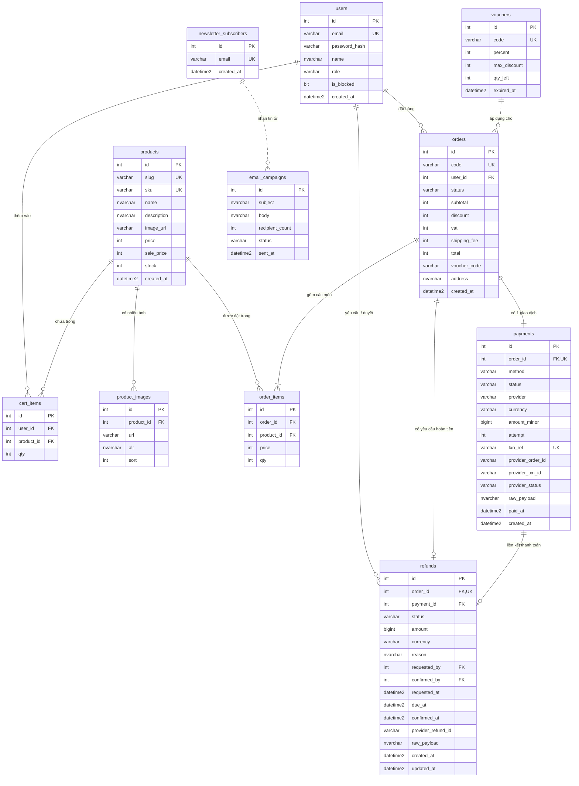
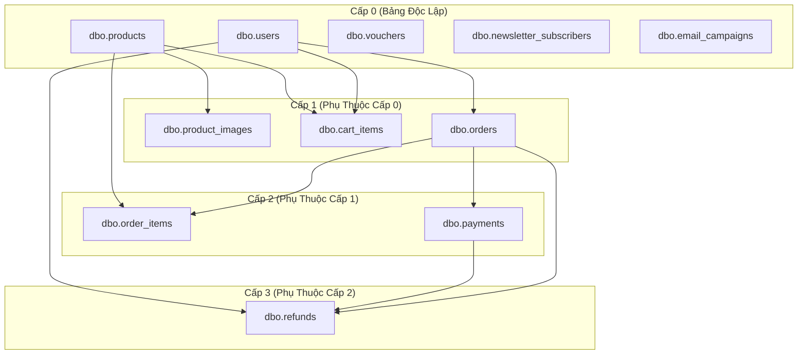

# Danh Mục & Đặc Tả Cấu Trúc Các Bảng CSDL ElectroHub (Data Dictionary)

Hệ thống cơ sở dữ liệu **ElectroHub** được xây dựng trên nền tảng **Microsoft SQL Server 2022**, phục vụ cho nền tảng thương mại điện tử chuyên doanh linh kiện điện tử, vi điều khiển (ESP32, STM32, Arduino), cảm biến và module IoT.

Tài liệu này tổng hợp đặc tả chi tiết toàn bộ các bảng dữ liệu (Data Dictionary), bao gồm kiểu dữ liệu, các ràng buộc toàn vẹn (PK, FK, Unique, Check), quy tắc nghiệp vụ (Rules), giá trị mặc định (Defaults), chỉ mục (Indexes), cũng như các Trigger, Stored Procedure và View liên quan.

---

## 📑 Mục Lục

1. [Tổng Quan Danh Mục Bảng](#-tổng-quan-danh-mục-bảng)
2. [Sơ Đồ Quan Hệ Thực Thể (ERD)](#-sơ-đồ-quan-hệ-thực-thể-erd)
3. [Thứ Tự Phụ Thuộc & Nạp Dữ Liệu](#-thứ-tự-phụ-thuộc--nạp-dữ-liệu)
4. [Đặc Tả Chi Tiết Từng Bảng](#-đặc-tả-chi-tiết-từng-bảng)
   - [1. dbo.users](#1-bảng-dbousers-tài-khoản--người-dùng)
   - [2. dbo.products](#2-bảng-dboproducts-danh-mục-sản-phẩm--linh-kiện)
   - [3. dbo.product_images](#3-bảng-dboproduct_images-bộ-sưu-tập-ảnh-sản-phẩm)
   - [4. dbo.vouchers](#4-bảng-dbovouchers-mã-giảm-giá--khuyến-mãi)
   - [5. dbo.cart_items](#5-bảng-dbocart_items-giỏ-hàng-người-dùng)
   - [6. dbo.orders](#6-bảng-dboorders-đơn-đặt-hàng)
   - [7. dbo.order_items](#7-bảng-dboorder_items-chi-tiết-mặt-hàng-đơn)
   - [8. dbo.payments](#8-bảng-dbopayments-giao-dịch-thanh-toán)
   - [9. dbo.refunds](#9-bảng-dborefunds-yêu-cầu-hoàn-tiền--escrow-72h)
   - [10. dbo.newsletter_subscribers](#10-bảng-dbonewsletter_subscribers-đăng-ký-bản-tin)
   - [11. dbo.email_campaigns](#11-bảng-dboemail_campaigns-chiến-dịch-email-marketing)
5. [Bảng Ma Trận Tích Hợp T-SQL Nâng Cao](#-bảng-ma-trận-tích-hợp-t-sql-nâng-cao)

---

## 📊 Tổng Quan Danh Mục Bảng

Hệ thống cơ sở dữ liệu ElectroHub gồm **11 bảng nghiệp vụ**, được chia thành 4 phân hệ chính:

| STT | Tên Bảng | Phân Hệ | Số Cột | Khóa Chính (PK) | Mục Đích Nghiệp Vụ |
| :---: | :--- | :--- | :---: | :--- | :--- |
| **1** | `dbo.users` | Người dùng & Phân quyền | 7 | `id` (INT) | Quản lý tài khoản khách hàng, nhân viên và quản trị viên |
| **2** | `dbo.products` | Sản phẩm & Tồn kho | 10 | `id` (INT) | Danh mục linh kiện điện tử, giá bán, tồn kho |
| **3** | `dbo.product_images` | Sản phẩm & Media | 5 | `id` (INT) | Bộ sưu tập nhiều góc chụp / slideshow cho sản phẩm |
| **4** | `dbo.vouchers` | Khuyến mãi | 6 | `id` (INT) | Mã giảm giá %, hạn mức tối đa, số lượng và hạn dùng |
| **5** | `dbo.cart_items` | Mua sắm (Storefront) | 4 | `id` (INT) | Giỏ hàng trực tuyến của từng khách hàng trước khi checkout |
| **6** | `dbo.orders` | Bán hàng & Đơn hàng | 12 | `id` (INT) | Thông tin đơn đặt hàng, tổng tiền, thuế VAT, địa chỉ giao |
| **7** | `dbo.order_items` | Bán hàng & Đơn hàng | 5 | `id` (INT) | Danh sách sản phẩm, số lượng và đơn giá tại thời điểm mua |
| **8** | `dbo.payments` | Thanh toán | 15 | `id` (INT) | Giao dịch cổng thanh toán (COD, Mock, PayOS, VNPay, ZaloPay) |
| **9** | `dbo.refunds` | Sau bán hàng & Kế toán | 16 | `id` (INT) | Quản lý yêu cầu hoàn tiền và chính sách giữ tiền 72 giờ |
| **10** | `dbo.newsletter_subscribers` | Marketing | 3 | `id` (INT) | Danh sách email đăng ký nhận tin khuyến mãi |
| **11** | `dbo.email_campaigns` | Marketing | 6 | `id` (INT) | Lịch sử các chiến dịch gửi email tin tức / khuyến mãi |

---

## 🗺️ Sơ Đồ Quan Hệ Thực Thể (ERD)

---

## 🔄 Thứ Tự Phụ Thuộc & Nạp Dữ Liệu

Khi khởi tạo cơ sở dữ liệu hoặc nạp dữ liệu mẫu (`08_seed_data.sql`), các bảng phải được tạo và nạp theo đúng thứ tự phân tầng phụ thuộc:

---

## 🔍 Đặc Tả Chi Tiết Từng Bảng

---

### 1. Bảng `dbo.users` (Tài khoản & Người dùng)

- **Mục đích**: Lưu trữ thông tin tài khoản người dùng, bao gồm thông tin đăng nhập, phân quyền vai trò (Admin, Staff, Customer), và cờ trạng thái khóa tài khoản.
- **Tập tin DDL gốc**: `sql/01_ddl_tables.sql` & Alembic Migration `0015_user_block.py`.

#### Cấu Trúc Cột

| Tên Cột | Kiểu Dữ Liệu | Nullable | Khóa | Mặc Định | Ràng Buộc / Rules | Mô Tả Nghiệp Vụ |
| :--- | :--- | :---: | :---: | :--- | :--- | :--- |
| `id` | `INT IDENTITY(1,1)` | **NO** | **PK** | Tự tăng (1, 1) | — | Mã định danh duy nhất của người dùng |
| `email` | `VARCHAR(255)` | **NO** | **UK** | — | Unique Index | Địa chỉ email đăng nhập (không trùng lặp) |
| `password_hash` | `VARCHAR(255)` | **NO** | — | — | Hash bcrypt | Mật khẩu đã được mã hóa an toàn |
| `name` | `NVARCHAR(100)` | **NO** | — | — | — | Họ tên đầy đủ của người dùng |
| `role` | `VARCHAR(20)` | **NO** | — | `'customer'` | `IN ('admin', 'staff', 'customer')` Gán `rule_VaiTroNguoiDung` | Vai trò người dùng trong hệ sinh thái |
| `is_blocked` | `BIT` | **NO** | — | `0` (False) | — | Cờ khóa tài khoản (1: bị khóa, 0: hoạt động) |
| `created_at` | `DATETIME2` | **NO** | — | `SYSUTCDATETIME()` | Gán `def_NgayHienTaiUTC` | Thời điểm tạo tài khoản (UTC) |

#### Chỉ Mục & Ràng Buộc
- **Primary Key**: `pk_users` Clustered trên cột `id`.
- **Unique Constraint**: `uq_users_email` Nonclustered trên cột `email`.
- **Nonclustered Index**: `ix_users_role` trên cột `role` (tối ưu truy vấn danh sách theo vai trò).
- **Check Constraint**: `ck_users_role` (`role IN ('admin', 'staff', 'customer')`).
- **Rule & Default**: Bắt buộc tuân thủ `rule_VaiTroNguoiDung` và mặc định `def_NgayHienTaiUTC`.

#### Bảng Tham Chiếu & Đối Tượng Liên Quan
- **Được tham chiếu bởi**:
  - `dbo.cart_items(user_id)`: Xóa user sẽ tự động xóa giỏ hàng (`ON DELETE CASCADE`).
  - `dbo.orders(user_id)`: Khóa ngoại bảo vệ toàn vẹn lịch sử đơn hàng (`NO ACTION`).
  - `dbo.refunds(requested_by, confirmed_by)`: Ghi nhận vết người tạo/duyệt hoàn tiền.
- **Thủ tục / Hàm liên quan**:
  - `dbo.sp_TaoDonHangTuGioHang`: Tạo đơn hàng cho `user_id`.
  - `dbo.sp_Cursor_PhanHangVaTangVoucherKhachHang`: Quét doanh số của từng `user_id` để xét VIP.
  - `dbo.fn_LichSuDonHangUser(@UserId)`: Hàm bảng xem toàn bộ lịch sử mua hàng của khách.

---

### 2. Bảng `dbo.products` (Danh mục Sản phẩm & Linh kiện)

- **Mục đích**: Quản lý thông tin các linh kiện điện tử, vi điều khiển, cảm biến, giá bán, giá khuyến mãi và số lượng tồn kho thực tế.
- **Tập tin DDL gốc**: `sql/01_ddl_tables.sql`.

#### Cấu Trúc Cột

| Tên Cột | Kiểu Dữ Liệu | Nullable | Khóa | Mặc Định | Ràng Buộc / Rules | Mô Tả Nghiệp Vụ |
| :--- | :--- | :---: | :---: | :--- | :--- | :--- |
| `id` | `INT IDENTITY(1,1)` | **NO** | **PK** | Tự tăng (1, 1) | — | Mã định danh sản phẩm |
| `slug` | `VARCHAR(200)` | **NO** | **UK** | — | Unique Index | Chuỗi định danh URL thân thiện SEO (duy nhất) |
| `sku` | `VARCHAR(32)` | **NO** | **UK** | — | Unique Index | Mã quản lý kho (VD: `EH-ESP32`, `EH-UNO-R3`) |
| `name` | `NVARCHAR(200)` | **NO** | — | — | Nonclustered Index | Tên thương mại của linh kiện / sản phẩm |
| `description` | `NVARCHAR(MAX)` | YES | — | NULL | — | Mô tả kỹ thuật, thông số chi tiết, sơ đồ chân |
| `image_url` | `VARCHAR(500)` | **NO** | — | `'/static/img/product-placeholder.svg'` | — | Đường dẫn ảnh đại diện chính của sản phẩm |
| `price` | `INT` | **NO** | — | — | `price >= 0` Gán `rule_GiaKhongAm` | Giá niêm yết (VNĐ) |
| `sale_price` | `INT` | YES | — | NULL | `sale_price <= price` Gán `rule_GiaKhongAm` | Giá khuyến mãi (VNĐ), không được lớn hơn `price` |
| `stock` | `INT` | **NO** | — | `0` | `stock >= 0` Gán `def_SoLuongMacDinhKhong` | Số lượng hàng tồn kho sẵn sàng bán |
| `created_at` | `DATETIME2` | **NO** | — | `SYSUTCDATETIME()` | Gán `def_NgayHienTaiUTC` | Thời điểm tạo sản phẩm (UTC) |

#### Chỉ Mục & Ràng Buộc
- **Primary Key**: `pk_products` Clustered trên cột `id`.
- **Unique Constraints**:
  - `uq_products_slug` Nonclustered trên `slug`.
  - `uq_products_sku` Nonclustered trên `sku`.
- **Nonclustered Index**: `ix_products_name` trên cột `name` (tối ưu tìm kiếm sản phẩm theo tên).
- **Check Constraints**:
  - `ck_products_price`: `price >= 0`.
  - `ck_products_sale_price`: `sale_price IS NULL OR (sale_price >= 0 AND sale_price <= price)`.
  - `ck_products_stock`: `stock >= 0`.

#### Tác Động T-SQL Nâng Cao
- **Triggers**:
  - `trg_KiemTraVaTruTonKho`: Khi chèn dòng vào `order_items`, trigger kiểm tra nếu `stock < qty` sẽ RAISERROR và ROLLBACK; nếu đủ hàng sẽ tự động `UPDATE stock = stock - qty`.
  - `trg_HoanKhoKhiHuyDonHang`: Khi `orders.status` chuyển sang `'cancelled'`, trigger tự động `UPDATE stock = stock + qty` trả lại hàng vào kho.
- **Thủ tục / Views**:
  - `dbo.sp_ThemSanPham`: Thêm sản phẩm mới kèm kiểm tra slug/sku duy nhất.
  - `dbo.v_ThongKeSanPhamVaDoanhSo`: View thống kê doanh số bán và tồn kho theo từng linh kiện.

---

### 3. Bảng `dbo.product_images` (Bộ sưu tập Ảnh Sản phẩm)

- **Mục đích**: Lưu trữ thư viện nhiều ảnh chi tiết (gallery/slideshow) của một sản phẩm (mặt trước, mặt sau, góc nghiêng, sơ đồ chân).
- **Tập tin DDL gốc**: Alembic Migration `0014_product_images.py` & `sql/08_seed_data.sql`.

#### Cấu Trúc Cột

| Tên Cột | Kiểu Dữ Liệu | Nullable | Khóa | Mặc Định | Ràng Buộc | Mô Tả Nghiệp Vụ |
| :--- | :--- | :---: | :---: | :--- | :--- | :--- |
| `id` | `INT IDENTITY(1,1)` | **NO** | **PK** | Tự tăng (1, 1) | — | Mã định danh bản ghi ảnh |
| `product_id` | `INT` | **NO** | **FK** | — | Tham chiếu `products(id)` | Mã sản phẩm sở hữu ảnh này |
| `url` | `VARCHAR(500)` | **NO** | — | — | — | Đường dẫn file ảnh WebP/PNG trên server/CDN |
| `alt` | `NVARCHAR(200)` | **NO** | — | `N''` | — | Văn bản thay thế mô tả ảnh (hỗ trợ SEO & Accessibility) |
| `sort` | `INT` | **NO** | — | `0` | — | Thứ tự sắp xếp hiển thị ảnh (0: ảnh đầu tiên) |

#### Chỉ Mục & Ràng Buộc
- **Primary Key**: `pk_product_images` Clustered trên cột `id`.
- **Foreign Key**: `fk_product_images_product_id_products` tham chiếu `dbo.products(id)` với hành vi `ON DELETE CASCADE` (khi xóa sản phẩm, toàn bộ ảnh gallery sẽ tự động bị xóa).
- **Nonclustered Index**: `ix_product_images_product_id` trên cột `product_id`.

---

### 4. Bảng `dbo.vouchers` (Mã giảm giá & Khuyến mãi)

- **Mục đích**: Quản lý các chương trình ưu đãi, mã giảm giá theo tỷ lệ phần trăm kèm mức giảm trần, số lượt sử dụng và thời hạn hiệu lực.
- **Tập tin DDL gốc**: `sql/01_ddl_tables.sql`.

#### Cấu Trúc Cột

| Tên Cột | Kiểu Dữ Liệu | Nullable | Khóa | Mặc Định | Ràng Buộc / Rules | Mô Tả Nghiệp Vụ |
| :--- | :--- | :---: | :---: | :--- | :--- | :--- |
| `id` | `INT IDENTITY(1,1)` | **NO** | **PK** | Tự tăng (1, 1) | — | Mã định danh voucher |
| `code` | `VARCHAR(32)` | **NO** | **UK** | — | Viết hoa, duy nhất | Ký tự mã voucher khách hàng nhập vào |
| `percent` | `INT` | **NO** | — | — | `BETWEEN 1 AND 100` Gán `rule_PhanTramVoucher` | Tỷ lệ phần trăm giảm giá (1% - 100%) |
| `max_discount` | `INT` | **NO** | — | — | `max_discount >= 0` | Số tiền giảm giá tối đa cho phép (VNĐ) |
| `qty_left` | `INT` | **NO** | — | — | `qty_left >= 0` | Số lượt còn lại có thể áp dụng |
| `expired_at` | `DATETIME2` | **NO** | — | — | — | Thời điểm hết hạn hiệu lực của voucher (UTC) |

#### Chỉ Mục & Ràng Buộc
- **Primary Key**: `pk_vouchers` Clustered trên cột `id`.
- **Unique Constraint**: `uq_vouchers_code` Nonclustered trên cột `code`.
- **Check Constraints**:
  - `ck_vouchers_percent`: `[percent] BETWEEN 1 AND 100`.
  - `ck_vouchers_max_discount`: `max_discount >= 0`.
  - `ck_vouchers_qty_left`: `qty_left >= 0`.

#### Tác Động T-SQL Nâng Cao
- **Hàm kiểm tra**: `dbo.fn_KiemTraVoucherHopLe(@Code)` trả về 1 nếu mã hợp lệ (còn lượt, chưa hết hạn) và 0 nếu không hợp lệ.
- **Triggers**: `trg_HoanKhoKhiHuyDonHang`: Khi hủy đơn có áp dụng voucher, tự động hoàn trả `qty_left = qty_left + 1`.
- **Cursors**: `dbo.sp_Cursor_PhanHangVaTangVoucherKhachHang`: Cursor tự động sinh các mã voucher VIP tặng cho khách mua nhiều hàng (`VIP-xxx` hoặc `LOYAL-xxx`).

---

### 5. Bảng `dbo.cart_items` (Giỏ hàng Người dùng)

- **Mục đích**: Lưu trữ các mặt hàng và số lượng mà khách hàng đã thêm vào giỏ nhưng chưa thực hiện đặt hàng (checkout).
- **Tập tin DDL gốc**: `sql/01_ddl_tables.sql`.

#### Cấu Trúc Cột

| Tên Cột | Kiểu Dữ Liệu | Nullable | Khóa | Mặc Định | Ràng Buộc / Rules | Mô Tả Nghiệp Vụ |
| :--- | :--- | :---: | :---: | :--- | :--- | :--- |
| `id` | `INT IDENTITY(1,1)` | **NO** | **PK** | Tự tăng (1, 1) | — | Mã định danh bản ghi trong giỏ |
| `user_id` | `INT` | **NO** | **FK** | — | Tham chiếu `users(id)` | Chủ sở hữu của giỏ hàng |
| `product_id` | `INT` | **NO** | **FK** | — | Tham chiếu `products(id)` | Mặt hàng được thêm vào giỏ |
| `qty` | `INT` | **NO** | — | `1` | `BETWEEN 1 AND 99` Gán `rule_SoLuongHopLe` | Số lượng chọn mua (tối đa 99 cái/món) |

#### Chỉ Mục & Ràng Buộc
- **Primary Key**: `pk_cart_items` Clustered trên cột `id`.
- **Unique Constraint**: `uq_cart_items_user_product` Nonclustered trên cặp `(user_id, product_id)` (chống trùng lặp sản phẩm trong cùng một giỏ).
- **Foreign Keys**:
  - `fk_cart_items_users` -> `dbo.users(id)` `ON DELETE CASCADE`.
  - `fk_cart_items_products` -> `dbo.products(id)` `ON DELETE CASCADE`.
- **Nonclustered Index**: `ix_cart_items_user_id` trên `user_id` (tối ưu hiển thị giỏ hàng).

#### Thủ Tục Liên Quan
- `dbo.sp_TaoDonHangTuGioHang`: Khi người dùng bấm đặt hàng, Stored Procedure sẽ dùng Transaction để đọc toàn bộ giỏ hàng, tạo đơn hàng trong `orders`, thêm các món vào `order_items`, và tự động xóa giỏ hàng tương ứng.

---

### 6. Bảng `dbo.orders` (Đơn đặt hàng)

- **Mục đích**: Quản lý thông tin tổng quan của đơn hàng: mã đơn, khách mua, trạng thái xử lý, các khoản tiền cấu thành (tiền hàng, giảm giá, thuế VAT 10%, phí vận chuyển) và địa chỉ nhận hàng.
- **Tập tin DDL gốc**: `sql/01_ddl_tables.sql`.

#### Cấu Trúc Cột

| Tên Cột | Kiểu Dữ Liệu | Nullable | Khóa | Mặc Định | Ràng Buộc / Rules | Mô Tả Nghiệp Vụ |
| :--- | :--- | :---: | :---: | :--- | :--- | :--- |
| `id` | `INT IDENTITY(1,1)` | **NO** | **PK** | Tự tăng (1, 1) | — | Mã định danh đơn hàng (khóa nội bộ) |
| `code` | `VARCHAR(12)` | **NO** | **UK** | — | Dạng `ORD-...` | Mã đơn hàng hiển thị cho khách và tra cứu |
| `user_id` | `INT` | **NO** | **FK** | — | Tham chiếu `users(id)` | Khách hàng thực hiện đặt đơn |
| `status` | `VARCHAR(16)` | **NO** | — | `'pending'` | Xem chi tiết bên dưới Gán `rule_TrangThaiDonHang` | Trạng thái hiện tại của đơn hàng |
| `subtotal` | `INT` | **NO** | — | — | `>= 0` | Tổng giá trị hàng trước khi trừ voucher (VNĐ) |
| `discount` | `INT` | **NO** | — | `0` | `>= 0` Gán `def_SoLuongMacDinhKhong` | Số tiền được giảm trừ từ voucher (VNĐ) |
| `vat` | `INT` | **NO** | — | `0` | `>= 0` Gán `def_SoLuongMacDinhKhong` | Thuế VAT (10% của `subtotal - discount`) |
| `shipping_fee` | `INT` | **NO** | — | `30000` | `>= 0` Gán `def_PhiVanChuyenTieuChuan` | Phí giao hàng tiêu chuẩn (VNĐ) |
| `total` | `INT` | **NO** | — | — | `>= 0` | Tổng tiền thanh toán cuối cùng |
| `voucher_code` | `VARCHAR(32)` | YES | — | NULL | — | Mã voucher đã áp dụng vào đơn (nếu có) |
| `address` | `NVARCHAR(MAX)` | **NO** | — | — | — | Địa chỉ người nhận, số điện thoại, ghi chú giao |
| `created_at` | `DATETIME2` | **NO** | — | `SYSUTCDATETIME()` | Gán `def_NgayHienTaiUTC` | Thời điểm đặt đơn hàng (UTC) |

#### Vòng Đời Trạng Thái Đơn Hàng (`status`)
Trạng thái được kiểm soát bởi ràng buộc `ck_orders_status` và `rule_TrangThaiDonHang`:
- `'pending'`: Đơn mới tạo, đang chờ xử lý hoặc chờ thanh toán trực tuyến.
- `'confirmed'`: Đơn đã được xác nhận / đã thanh toán, sẵn sàng đóng gói.
- `'shipping'`: Đang bàn giao cho đơn vị vận chuyển giao tới khách.
- `'done'`: Giao hàng thành công, đơn hàng đóng hoàn tất.
- `'cancelled'`: Đơn bị hủy (bởi khách hàng, admin hoặc tự động hủy do hết hạn).

#### Chỉ Mục & Ràng Buộc
- **Primary Key**: `pk_orders` Clustered trên cột `id`.
- **Unique Constraint**: `uq_orders_code` Nonclustered trên `code`.
- **Foreign Key**: `fk_orders_users` tham chiếu `dbo.users(id)`.
- **Nonclustered Indexes**:
  - `ix_orders_user_id` trên `user_id`.
  - `ix_orders_status` trên `status`.
  - `ix_orders_created_at` trên `created_at DESC` (tối ưu báo cáo và danh sách mới nhất).

#### Tác Động T-SQL Nâng Cao
- **Triggers**:
  - `trg_HoanKhoKhiHuyDonHang`: Lắng nghe sự kiện chuyển `status = 'cancelled'` để tự động hoàn trả tồn kho và lượt voucher.
  - `trg_ChongSuaXoaDonHangDaDong` (`INSTEAD OF DELETE, UPDATE`): Tuyệt đối không cho phép xóa đơn đang giao (`shipping`) hoặc đã đóng (`done`); ngăn chặn sửa đổi đơn đã ở trạng thái kết thúc (`done`, `cancelled`).
- **Thủ tục & Hàm**:
  - `dbo.sp_CapNhatTrangThaiDonHang`: Chuyển trạng thái đơn tuần tự theo đúng quy trình nghiệp vụ.
  - `dbo.sp_HuyDonHangVaYeuCauHoanTien`: Hủy đơn có thanh toán online và chuyển tiếp sang bảng `refunds`.
  - `dbo.sp_Cursor_XuLyDonHangPendingQuaHan`: Cursor tự động quét và hủy các đơn `pending` quá thời gian quy định.
  - `dbo.v_ChiTietDonHangTongHop`, `dbo.v_BaoCaoDoanhThuTheoThang`: Các View báo cáo phân tích tổng hợp.

---

### 7. Bảng `dbo.order_items` (Chi tiết Mặt hàng Đơn)

- **Mục đích**: Lưu vết danh sách từng linh kiện trong đơn hàng, số lượng đặt mua và giá chốt bán tại thời điểm đặt (độc lập với việc sản phẩm sau đó có tăng/giảm giá).
- **Tập tin DDL gốc**: `sql/01_ddl_tables.sql`.

#### Cấu Trúc Cột

| Tên Cột | Kiểu Dữ Liệu | Nullable | Khóa | Mặc Định | Ràng Buộc / Rules | Mô Tả Nghiệp Vụ |
| :--- | :--- | :---: | :---: | :--- | :--- | :--- |
| `id` | `INT IDENTITY(1,1)` | **NO** | **PK** | Tự tăng (1, 1) | — | Mã định danh dòng chi tiết |
| `order_id` | `INT` | **NO** | **FK** | — | Tham chiếu `orders(id)` | Thuộc về đơn hàng nào |
| `product_id` | `INT` | **NO** | **FK** | — | Tham chiếu `products(id)` | Sản phẩm / linh kiện được đặt mua |
| `price` | `INT` | **NO** | — | — | `price >= 0` Gán `rule_GiaKhongAm` | Giá bán tại thời điểm đặt (VNĐ) |
| `qty` | `INT` | **NO** | — | — | `BETWEEN 1 AND 99` Gán `rule_SoLuongHopLe` | Số lượng mua của mặt hàng này |

#### Chỉ Mục & Ràng Buộc
- **Primary Key**: `pk_order_items` Clustered trên cột `id`.
- **Foreign Keys**:
  - `fk_order_items_orders` tham chiếu `dbo.orders(id)` với hành vi `ON DELETE CASCADE`.
  - `fk_order_items_products` tham chiếu `dbo.products(id)` (`NO ACTION`).
- **Nonclustered Indexes**:
  - `ix_order_items_order_id` trên `order_id`.
  - `ix_order_items_product_id` trên `product_id`.

#### Tác Động T-SQL Nâng Cao
- **Trigger**: `trg_KiemTraVaTruTonKho` (`AFTER INSERT`): Kiểm tra tồn kho của từng mặt hàng trong `products`. Nếu thiếu hàng lập tức RAISERROR và ROLLBACK; nếu đủ hàng sẽ tự động trừ `stock`.

---

### 8. Bảng `dbo.payments` (Giao dịch Thanh toán)

- **Mục đích**: Quản lý toàn bộ thông tin thanh toán cho đơn hàng, hỗ trợ cả hình thức COD, thanh toán mô phỏng (Mock), và các cổng thanh toán trực tuyến (PayOS, VNPay, ZaloPay).
- **Tập tin DDL gốc**: `sql/01_ddl_tables.sql`.

#### Cấu Trúc Cột

| Tên Cột | Kiểu Dữ Liệu | Nullable | Khóa | Mặc Định | Ràng Buộc | Mô Tả Nghiệp Vụ |
| :--- | :--- | :---: | :---: | :--- | :--- | :--- |
| `id` | `INT IDENTITY(1,1)` | **NO** | **PK** | Tự tăng (1, 1) | — | Mã giao dịch nội bộ |
| `order_id` | `INT` | **NO** | **FK, UK** | — | Tham chiếu `orders(id)` | Mã đơn hàng (quan hệ 1 - 1 duy nhất) |
| `method` | `VARCHAR(32)` | **NO** | — | — | — | Phương thức (`COD`, `mock`, `payos`, `vnpay`, `zalopay`) |
| `status` | `VARCHAR(20)` | **NO** | — | `'pending'` | Xem bên dưới | Trạng thái thanh toán của đơn |
| `provider` | `VARCHAR(32)` | **NO** | — | `'mock'` | — | Tên nhà cung cấp cổng thanh toán |
| `currency` | `VARCHAR(8)` | **NO** | — | `'VND'` | — | Loại tiền tệ thanh toán |
| `amount_minor` | `BIGINT` | YES | — | NULL | — | Số tiền giao dịch tính theo đơn vị minor |
| `attempt` | `INT` | **NO** | — | `1` | — | Số lần nỗ lực thực hiện giao dịch |
| `txn_ref` | `VARCHAR(64)` | YES | **UK\*** | NULL | Filtered Index | Mã tham chiếu giao dịch gửi sang cổng |
| `provider_order_id` | `VARCHAR(128)` | YES | — | NULL | — | Mã đơn phía đối tác cổng thanh toán trả về |
| `provider_txn_id` | `VARCHAR(128)` | YES | — | NULL | — | Mã giao dịch cổng thanh toán cung cấp |
| `provider_status` | `VARCHAR(64)` | YES | — | NULL | — | Trạng thái nguyên bản từ cổng thanh toán |
| `raw_payload` | `NVARCHAR(MAX)` | YES | — | NULL | — | Toàn bộ dữ liệu JSON webhook/API trả về để đối soát |
| `paid_at` | `DATETIME2` | YES | — | NULL | — | Thời điểm hoàn tất thanh toán thành công (UTC) |
| `created_at` | `DATETIME2` | **NO** | — | `SYSUTCDATETIME()` | — | Thời điểm khởi tạo bản ghi thanh toán (UTC) |

#### Trạng Thái Thanh Toán (`status`)
Kiểm soát bởi ràng buộc `ck_payments_status`:
- `'pending'`: Đang chờ khách quét mã / chuyển tiền.
- `'paid'`: Đã thanh toán thành công.
- `'failed'`: Giao dịch thanh toán thất bại hoặc hết hạn.
- `'refund_pending'`: Đang chờ xử lý hoàn tiền lại cho khách.
- `'refunded'`: Tiền đã được hoàn lại thành công vào tài khoản khách.

#### Chỉ Mục & Ràng Buộc
- **Primary Key**: `pk_payments` Clustered trên cột `id`.
- **Unique Constraint**: `uq_payments_order_id` Nonclustered trên `order_id` (đảm bảo mỗi đơn hàng chỉ gắn với 1 bản ghi payment).
- **Filtered Unique Index**: `uq_payments_txn_ref` trên cột `txn_ref WHERE txn_ref IS NOT NULL`.
- **Foreign Key**: `fk_payments_orders` tham chiếu `dbo.orders(id)` `ON DELETE CASCADE`.
- **Nonclustered Index**: `ix_payments_status` trên `status`.

---

### 9. Bảng `dbo.refunds` (Yêu cầu Hoàn tiền & Escrow 72h)

- **Mục đích**: Triển khai cơ chế an toàn tài chính (Hold / Escrow). Khi khách hủy đơn đã trả tiền online, tiền sẽ được đưa vào hàng đợi giữ lại **72 giờ** trước khi hệ thống chính thức giải ngân hoàn tiền.
- **Tập tin DDL gốc**: `sql/01_ddl_tables.sql`.

#### Cấu Trúc Cột

| Tên Cột | Kiểu Dữ Liệu | Nullable | Khóa | Mặc Định | Ràng Buộc | Mô Tả Nghiệp Vụ |
| :--- | :--- | :---: | :---: | :--- | :--- | :--- |
| `id` | `INT IDENTITY(1,1)` | **NO** | **PK** | Tự tăng (1, 1) | — | Mã yêu cầu hoàn tiền |
| `order_id` | `INT` | **NO** | **FK, UK** | — | Tham chiếu `orders(id)` | Đơn hàng phát sinh yêu cầu hoàn |
| `payment_id` | `INT` | **NO** | **FK** | — | Tham chiếu `payments(id)` | Giao dịch thanh toán gốc cần hoàn |
| `status` | `VARCHAR(20)` | **NO** | — | `'scheduled'` | Xem bên dưới | Trạng thái xử lý hoàn tiền |
| `amount` | `BIGINT` | **NO** | — | — | `amount > 0` | Số tiền hoàn trả cho khách (VNĐ) |
| `currency` | `VARCHAR(8)` | **NO** | — | `'VND'` | — | Loại tiền tệ |
| `reason` | `NVARCHAR(255)` | YES | — | NULL | — | Lý do hoàn tiền (khách hủy, hết hàng...) |
| `requested_by` | `INT` | YES | **FK** | NULL | Tham chiếu `users(id)` | Người gửi yêu cầu hoàn tiền |
| `confirmed_by` | `INT` | YES | **FK** | NULL | Tham chiếu `users(id)` | Nhân viên / Quản trị viên xét duyệt |
| `requested_at` | `DATETIME2` | **NO** | — | `SYSUTCDATETIME()` | — | Thời điểm tiếp nhận yêu cầu |
| `due_at` | `DATETIME2` | **NO** | — | — | Phải sau `requested_at` | Hạn chót 72 giờ giữ tiền (ngày được phép giải ngân) |
| `confirmed_at` | `DATETIME2` | YES | — | NULL | — | Thời điểm nhân viên xác nhận |
| `provider_refund_id`| `VARCHAR(128)` | YES | — | NULL | — | Mã tham chiếu hoàn tiền từ đối tác cổng |
| `raw_payload` | `NVARCHAR(MAX)` | YES | — | NULL | — | Dữ liệu phản hồi gốc từ đối tác thanh toán |
| `created_at` | `DATETIME2` | **NO** | — | `SYSUTCDATETIME()` | — | Thời điểm tạo bản ghi (UTC) |
| `updated_at` | `DATETIME2` | **NO** | — | `SYSUTCDATETIME()` | — | Thời điểm cập nhật cuối (UTC) |

#### Trạng Thái Hoàn Tiền (`status`)
Kiểm soát bởi ràng buộc `ck_refunds_status`:
- `'scheduled'`: Đang trong thời gian giữ tiền 72 giờ (chưa đến `due_at`).
- `'processing'`: Đang gửi lệnh giải ngân sang cổng thanh toán.
- `'succeeded'`: Hoàn tiền thành công tới tài khoản của khách.
- `'failed'`: Lệnh hoàn tiền bị lỗi từ phía cổng thanh toán.
- `'rejected'`: Yêu cầu hoàn tiền bị nhân viên từ chối hợp lệ.

#### Chỉ Mục & Ràng Buộc
- **Primary Key**: `pk_refunds` Clustered trên cột `id`.
- **Unique Constraint**: `uq_refunds_order_id` Nonclustered trên `order_id`.
- **Foreign Keys**:
  - `fk_refunds_orders` tham chiếu `dbo.orders(id)`.
  - `fk_refunds_payments` tham chiếu `dbo.payments(id)`.
  - `fk_refunds_requested_by` tham chiếu `dbo.users(id)`.
  - `fk_refunds_confirmed_by` tham chiếu `dbo.users(id)`.
- **Nonclustered Composite Index**: `ix_refunds_status_due_at` trên `(status, due_at)` (tối ưu cực cao cho tiến trình định kỳ quét các khoản đến hạn).

#### Tác Động T-SQL Nâng Cao
- **Trigger**: `trg_DongBoThanhToanKhiHoanTien` (`AFTER UPDATE`): Khi trạng thái chuyển sang `'succeeded'`, trigger tự động cập nhật bảng `payments` tương ứng sang `status = 'refunded'`.
- **Thủ tục & Cursor**:
  - `dbo.sp_HuyDonHangVaYeuCauHoanTien`: Hủy đơn, tính `due_at = DATEADD(HOUR, 72, SYSUTCDATETIME())` và tự động ghi vào `refunds`.
  - `dbo.sp_Cursor_QuetKiemTraYeuCauHoanTien`: Quét con trỏ các khoản hoàn tiền đủ hạn 72h để giải ngân tự động.

---

### 10. Bảng `dbo.newsletter_subscribers` (Đăng ký Bản tin)

- **Mục đích**: Thu thập và quản lý danh sách email của khách hàng quan tâm đến các chương trình khuyến mãi, bài viết kỹ thuật và sản phẩm công nghệ mới.
- **Tập tin DDL gốc**: `sql/01_ddl_tables.sql`.

#### Cấu Trúc Cột

| Tên Cột | Kiểu Dữ Liệu | Nullable | Khóa | Mặc Định | Ràng Buộc | Mô Tả Nghiệp Vụ |
| :--- | :--- | :---: | :---: | :--- | :--- | :--- |
| `id` | `INT IDENTITY(1,1)` | **NO** | **PK** | Tự tăng (1, 1) | — | Mã định danh người đăng ký |
| `email` | `VARCHAR(255)` | **NO** | **UK** | — | Unique Index | Địa chỉ email nhận bản tin (duy nhất) |
| `created_at` | `DATETIME2` | **NO** | — | `SYSUTCDATETIME()` | — | Thời điểm bấm đăng ký nhận tin (UTC) |

#### Chỉ Mục & Ràng Buộc
- **Primary Key**: `pk_newsletter_subscribers` Clustered trên cột `id`.
- **Unique Constraint**: `uq_newsletter_subscribers_email` Nonclustered trên cột `email`.

---

### 11. Bảng `dbo.email_campaigns` (Chiến dịch Email Marketing)

- **Mục đích**: Lưu trữ nội dung, số lượng người nhận và nhật ký gửi các chiến dịch email marketing từ quản trị viên đến danh sách người đăng ký.
- **Tập tin DDL gốc**: `sql/01_ddl_tables.sql`.

#### Cấu Trúc Cột

| Tên Cột | Kiểu Dữ Liệu | Nullable | Khóa | Mặc Định | Ràng Buộc | Mô Tả Nghiệp Vụ |
| :--- | :--- | :---: | :---: | :--- | :--- | :--- |
| `id` | `INT IDENTITY(1,1)` | **NO** | **PK** | Tự tăng (1, 1) | — | Mã chiến dịch gửi email |
| `subject` | `NVARCHAR(255)` | **NO** | — | — | — | Tiêu đề thư gửi tới khách hàng |
| `body` | `NVARCHAR(MAX)` | **NO** | — | — | HTML / Markdown | Nội dung chi tiết của bức thư |
| `recipient_count`| `INT` | **NO** | — | `0` | `>= 0` | Tổng số lượng địa chỉ email đã được gửi |
| `status` | `VARCHAR(32)` | **NO** | — | `'sending'` | — | Trạng thái chiến dịch (`draft`, `sending`, `sent`, `failed`) |
| `sent_at` | `DATETIME2` | **NO** | — | `SYSUTCDATETIME()` | — | Thời điểm chiến dịch được phát đi (UTC) |

#### Chỉ Mục & Ràng Buộc
- **Primary Key**: `pk_email_campaigns` Clustered trên cột `id`.

---

## 🧩 Bảng Ma Trận Tích Hợp T-SQL Nâng Cao

Bảng dưới đây tổng hợp các đối tượng T-SQL nâng cao tác động trực tiếp lên từng bảng:

| Tên Bảng | Rules Đã Gán (`sp_bindrule`) | Defaults Đã Gán (`sp_bindefault`) | Triggers Lắng Nghe | Stored Procedures & Cursors Chính | Views Liên Quan |
| :--- | :--- | :--- | :--- | :--- | :--- |
| `dbo.users` | `rule_VaiTroNguoiDung` (cột `role`) | `def_NgayHienTaiUTC` (cột `created_at`) | — | `sp_Cursor_PhanHangVaTangVoucherKhachHang` `sp_TaoDonHangTuGioHang` | `v_ChiTietDonHangTongHop` `fn_LichSuDonHangUser` |
| `dbo.products` | `rule_GiaKhongAm` (cột `price`, `sale_price`) | `def_NgayHienTaiUTC` (cột `created_at`) `def_SoLuongMacDinhKhong` (cột `stock`) | `trg_KiemTraVaTruTonKho` *(bị cập nhật)* `trg_HoanKhoKhiHuyDonHang` *(bị hoàn)* | `sp_ThemSanPham` | `v_ThongKeSanPhamVaDoanhSo` `v_ChiTietDonHangTongHop` |
| `dbo.product_images` | — | — | — | — | — |
| `dbo.vouchers` | `rule_PhanTramVoucher` (cột `percent`) | — | `trg_HoanKhoKhiHuyDonHang` *(bị hoàn lượt)* | `sp_Cursor_PhanHangVaTangVoucherKhachHang` | `fn_KiemTraVoucherHopLe` |
| `dbo.cart_items` | `rule_SoLuongHopLe` (cột `qty`) | — | — | `sp_TaoDonHangTuGioHang` *(đọc & dọn sạch)* | — |
| `dbo.orders` | `rule_TrangThaiDonHang` (cột `status`) | `def_NgayHienTaiUTC` (cột `created_at`) `def_PhiVanChuyenTieuChuan` (`shipping_fee`) `def_SoLuongMacDinhKhong` (`discount`, `vat`) | `trg_HoanKhoKhiHuyDonHang` `trg_ChongSuaXoaDonHangDaDong` | `sp_TaoDonHangTuGioHang` `sp_CapNhatTrangThaiDonHang` `sp_HuyDonHangVaYeuCauHoanTien` `sp_Cursor_XuLyDonHangPendingQuaHan` `sp_BaoCaoDoanhThu` | `v_ChiTietDonHangTongHop` `v_BaoCaoDoanhThuTheoThang` `fn_TinhTongTienDonHang` `fn_LichSuDonHangUser` |
| `dbo.order_items` | `rule_GiaKhongAm` (cột `price`) `rule_SoLuongHopLe` (cột `qty`) | — | `trg_KiemTraVaTruTonKho` | `sp_TaoDonHangTuGioHang` | `v_ChiTietDonHangTongHop` `v_ThongKeSanPhamVaDoanhSo` |
| `dbo.payments` | — | — | `trg_DongBoThanhToanKhiHoanTien` *(bị cập nhật)* | `sp_TaoDonHangTuGioHang` | `v_ChiTietDonHangTongHop` |
| `dbo.refunds` | — | — | `trg_DongBoThanhToanKhiHoanTien` | `sp_HuyDonHangVaYeuCauHoanTien` `sp_Cursor_QuetKiemTraYeuCauHoanTien` | — |
| `dbo.newsletter_subscribers` | — | — | — | — | — |
| `dbo.email_campaigns` | — | — | — | — | — |

---

> [!TIP]
> **Gợi ý kiểm thử & vận hành**:
> - Thứ tự khởi tạo toàn bộ database theo kịch bản: [`sql/master_setup.sql`](file:///Users/vandungdev/Documents/GitHub/ElectroHub/sql/master_setup.sql).
> - Để chạy kiểm thử tự động 100% các thành phần T-SQL trên Docker, xem hướng dẫn tại [`sql/README.md`](file:///Users/vandungdev/Documents/GitHub/ElectroHub/sql/README.md) hoặc chạy file [`sql/test_all.sql`](file:///Users/vandungdev/Documents/GitHub/ElectroHub/sql/test_all.sql).
